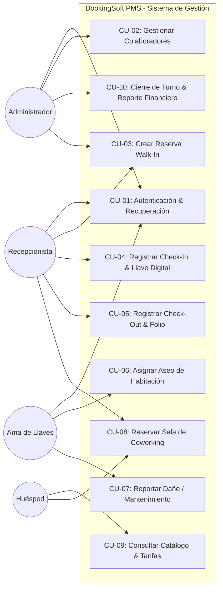
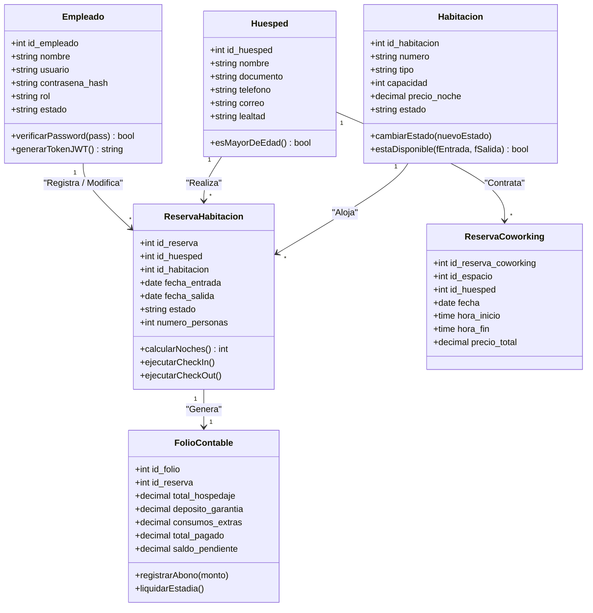
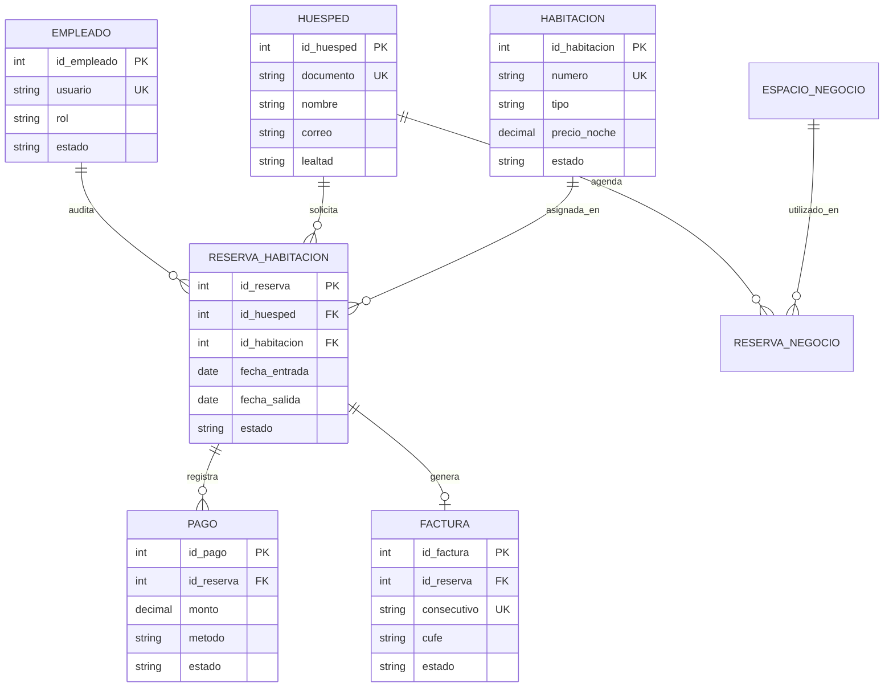
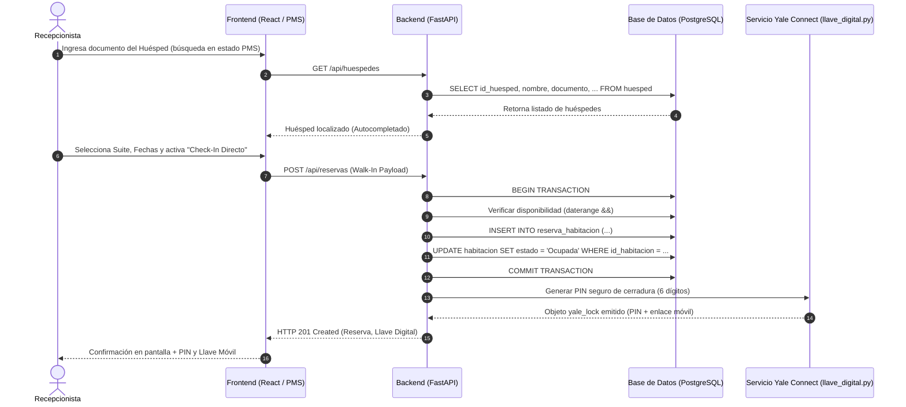

# 📐 Documentación General de Ingeniería de Software y Diagramas UML / MER / MR

**Proyecto:** BookingSoft PMS — Apartahotel Facile  
**Programa:** Análisis y Desarrollo de Software (ADSO) — SENA  
**Fecha:** Noviembre 2026  
**Autores:** Equipo de Desarrollo ADSO (Chico, Mayor, Echeverri, Parada, López)  

---

## 1. Diagrama de Arquitectura del Sistema (Criterio 5)

El sistema adopta una arquitectura desacoplada basada en microservicios orquestados mediante **Docker Compose**, asegurando alta disponibilidad, seguridad perimetral y aislamiento de red:

```mermaid
flowchart TD
    subgraph Cliente["Capa de Presentación (Frontend)"]
        User["Huésped / Recepcionista / Admin"] -->|HTTPS / HTTP :3001| Nginx["Nginx Reverse Proxy"]
        Nginx -->|Sirve SPA estática| ReactApp["React 18 + Vite SPA"]
    end

    subgraph Perimetro["Perímetro de Seguridad & Enrutamiento"]
        ReactApp -->|Peticiones /api/* (CORS + Bearer JWT)| APIGateway["FastAPI Gateway & Router :4000/:4001"]
    end

    subgraph Logica["Capa de Lógica de Negocio (Backend)"]
        APIGateway --> AuthModule["Módulo de Autenticación & RBAC"]
        APIGateway --> ReservasModule["Motor de Reservas & Disponibilidad"]
        APIGateway --> FolioModule["Módulo Contable & Liquidación COP"]
        APIGateway --> CoworkingModule["Módulo Centro de Negocios"]
        APIGateway --> MantenimientoModule["Módulo Ama de Llaves & Aseo"]
    end

    subgraph Persistencia["Capa de Persistencia de Datos"]
        AuthModule --> DBEngine["psycopg2 + ThreadedConnectionPool"]
        ReservasModule --> DBEngine
        FolioModule --> DBEngine
        CoworkingModule --> DBEngine
        MantenimientoModule --> DBEngine
        DBEngine -->|TCP :5432 / Protocolo Binario| Postgres[("PostgreSQL 15 (GiST + daterange)")]
    end

    subgraph Administracion["Monitoreo & Auditoría"]
        DBA["Administrador DBA"] -->|HTTP :5050| PgAdmin["pgAdmin 4"]
        PgAdmin --> Postgres
    end
```

---

## 2. Diagrama de Casos de Uso Global (UML)



---

## 3. Diagrama de Clases del Dominio (UML)



---

## 4. Modelo Entidad-Relación (MER) y Modelo Relacional (MR)

### 4.1 Modelo Entidad-Relación (ERD)



### 4.2 Modelo Relacional Normalizado (Tercera Forma Normal - 3FN)

A continuación se listan las tablas relacionales reales definidas en PostgreSQL (`backend/schema.sql`) con sus restricciones de integridad:

1. **`empleado`**  
   - `id_empleado` (`SERIAL`, PK)  
   - `nombre` (`VARCHAR(100)`, NOT NULL)  
   - `usuario` (`VARCHAR(50)`, UK, NOT NULL)  
   - `contrasena` (`VARCHAR(255)`, NOT NULL) — Hash Bcrypt  
   - `rol` (`VARCHAR(30)`, NOT NULL) — `['Grupo BookingSoft', 'Administrador', 'Recepcionista 24h', 'Ama de llaves', 'Personal de mantenimiento']`  
   - `tipo_documento` (`VARCHAR(30)`, NOT NULL, DEFAULT `'Cédula de ciudadanía'`)  
   - `numero_documento` (`VARCHAR(30)`, UK, NULL)  
   - `correo` (`VARCHAR(150)`, UK, NULL)  
   - `estado` (`VARCHAR(20)`, NOT NULL, DEFAULT `'Activo'`)

2. **`huesped`**  
   - `id_huesped` (`SERIAL`, PK)  
   - `nombre` (`VARCHAR(100)`, NOT NULL)  
   - `documento` (`VARCHAR(20)`, UK, NOT NULL)  
   - `telefono` (`VARCHAR(15)`, NOT NULL)  
   - `correo` (`VARCHAR(100)`, NOT NULL)  
   - `password_hash` (`VARCHAR(255)`, NULL)  
   - `empresa` (`VARCHAR(100)`, NULL)  
   - `lealtad` (`VARCHAR(20)`, NOT NULL, DEFAULT `'Silver'`) — `['Silver', 'Gold', 'Platinum']`  
   - `estado` (`VARCHAR(20)`, NOT NULL, DEFAULT `'Activo'`)  
   - `creado_por` (`VARCHAR(150)`), `modificado_por` (`VARCHAR(150)`)

3. **`habitacion`**  
   - `id_habitacion` (`SERIAL`, PK)  
   - `numero` (`VARCHAR(10)`, UK, NOT NULL)  
   - `tipo` (`VARCHAR(30)`, NOT NULL) — `['Dúplex', 'Dobles', 'Familiares', 'Habitaciones']`  
   - `capacidad` (`INT`, NOT NULL)  
   - `precio_noche` (`DECIMAL(10, 2)`, NOT NULL)  
   - `estado` (`VARCHAR(20)`, NOT NULL, DEFAULT `'Disponible'`) — `['Disponible', 'Ocupada', 'En limpieza', 'Mantenimiento']`  
   - `detalle_mantenimiento` (`TEXT`, NULL)  
   - `creado_por` (`VARCHAR(150)`), `modificado_por` (`VARCHAR(150)`)

4. **`reserva_habitacion`**  
   - `id_reserva` (`SERIAL`, PK)  
   - `id_huesped` (`INT`, FK ➔ `huesped.id_huesped`, NOT NULL)  
   - `id_habitacion` (`INT`, FK ➔ `habitacion.id_habitacion`, NOT NULL)  
   - `fecha_entrada` (`DATE`, NOT NULL)  
   - `fecha_salida` (`DATE`, NOT NULL)  
   - `estado` (`VARCHAR(20)`, NOT NULL, DEFAULT `'Confirmada'`) — `['Confirmada', 'Check-In', 'Completada', 'Cancelada']`  
   - `checkin_at` (`TIMESTAMP`, NULL), `checkout_at` (`TIMESTAMP`, NULL), `observaciones` (`VARCHAR(300)`, NULL)  
   - *Constraint:* `CHECK (fecha_salida > fecha_entrada)`  
   - *Exclusion Constraint (PostgreSQL):* `EXCLUDE USING gist (id_habitacion WITH =, daterange(fecha_entrada, fecha_salida) WITH &&) WHERE (estado IN ('Confirmada', 'Check-In'))`

5. **`pago`** *(y cálculo dinámico de folio en `backend/services/folio.py`)*  
   - `id_pago` (`SERIAL`, PK)  
   - `id_reserva` (`INT`, FK ➔ `reserva_habitacion.id_reserva`, NOT NULL)  
   - `monto` (`DECIMAL(12, 2)`, NOT NULL, `CHECK (monto > 0)`)  
   - `metodo` (`VARCHAR(30)`, NOT NULL) — `['Efectivo', 'Tarjeta de crédito', 'Tarjeta de débito', 'PSE', 'Nequi', 'Transferencia', 'Bono']`  
   - `estado` (`VARCHAR(20)`, NOT NULL, DEFAULT `'Confirmado'`) — `['Pendiente', 'Confirmado', 'Rechazado', 'Anulado', 'Reembolsado']`  
   - `referencia` (`VARCHAR(80)`), `referencia_gateway` (`VARCHAR(80)`), `gateway` (`VARCHAR(30)`, DEFAULT `'simulado'`)  
   - `creado_en` (`TIMESTAMP`), `modificado_en` (`TIMESTAMP`)

6. **`factura`** *(Comprobante XML UBL 2.1 simulado por reserva)*  
   - `id_factura` (`SERIAL`, PK)  
   - `id_reserva` (`INT`, FK ➔ `reserva_habitacion.id_reserva`, UK, NOT NULL)  
   - `consecutivo` (`VARCHAR(30)`, UK, NOT NULL)  
   - `cufe` (`VARCHAR(64)`, NOT NULL)  
   - `fecha_emision` (`TIMESTAMP`, NOT NULL)  
   - `estado` (`VARCHAR(20)`, NOT NULL, DEFAULT `'Borrador'`) — `['Borrador', 'Emitida', 'Anulada']`  
   - `xml` (`TEXT`, NOT NULL)

*(Nota: el módulo de coworking se persiste además en las tablas `espacio_negocio` y `reserva_negocio`).*

---

## 5. Diagrama de Secuencia: Flujo Walk-In con Check-In y Emisión de Llave




---
*Documento complementario al Criterio 1: Diagrama de arquitectura del sistema en 4 capas.*