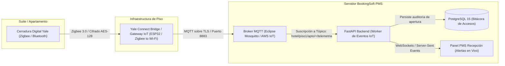

# 📡 Especificación de Arquitectura IoT y Protocolo de Comunicación (Bonificación)

**Proyecto:** BookingSoft PMS — Apartahotel Facile  
**Criterio de Evaluación:** Criterio 6 (Bonificación — Integración IoT)  
**Sistema:** Cerraduras Digitales Yale Connect SmartLock & Telemetría Hotelera  
**Estado de Implementación:** Arquitectura de integración lógica completada en Backend/PMS; especificación de protocolo para despliegue de hardware físico.  

---

## 1. Visión General de la Solución IoT

En la industria hotelera y de apartahoteles moderna, el acceso autónomo (*contactless check-in*) es fundamental. BookingSoft incorpora la arquitectura de integración para cerraduras inteligentes **Yale Connect Wi-Fi / Zigbee Bridge**, permitiendo que al momento de confirmarse una reserva o registrarse un Check-In presencial (Walk-In), el sistema:
1. Genere dinámicamente un código PIN temporal de 6 dígitos con validez acotada al rango de fechas `[fecha_entrada 15:00, fecha_salida 11:00]`.
2. Transmita la credencial al concentrador IoT del hotel (Gateway Yale Bridge).
3. Reciba telemetría en tiempo real: apertura de puertas, intentos fallidos y porcentaje de batería.

---

## 2. Diagrama de Arquitectura de Comunicación IoT

---

## 3. Protocolo de Comunicación y Estructura de Mensajes

### 3.1 Protocolo de Transporte
- **Protocolo:** **MQTT v5.0** (Message Queuing Telemetry Transport) sobre **TLS v1.3** con autenticación mutua por certificados X.509 (MQTTS, puerto 8883).
- **Justificación técnica:** MQTT es un protocolo binario ultraligero diseñado para dispositivos con restricciones de ancho de banda y batería, con niveles de QoS (Quality of Service) garantizados.
- **QoS Utilizado:** **QoS 1 (At least once)** para eventos de apertura y generación de llaves, asegurando que ningún código se pierda en tránsito.

---

### 3.2 Tópicos MQTT (Topic Hierarchy)

1. **Aprovisionamiento de Clave Temporal (PMS ➔ Cerradura):**  
   `hotel/facile/cerraduras/{id_habitacion}/comando/provisionar_pin`
2. **Revocación Inmediata de Clave (PMS ➔ Cerradura por Check-Out):**  
   `hotel/facile/cerraduras/{id_habitacion}/comando/revocar_pin`
3. **Telemetría y Estado de Batería (Cerradura ➔ PMS):**  
   `hotel/facile/cerraduras/{id_habitacion}/estado`
4. **Registro de Eventos de Acceso (Cerradura ➔ PMS):**  
   `hotel/facile/cerraduras/{id_habitacion}/eventos/apertura`

---

## 4. Formato de Payloads JSON

### 4.1 Mensaje de Aprovisionamiento de PIN al Huésped (Envío desde Backend)

| Campo | Tipo | Ejemplo | Descripción |
|---|---|---|---|
| `transaccion_id` | String | `tx_yale_982341` | Identificador único transaccional de aprovisionamiento |
| `id_habitacion` | Integer | `101` | Número identificador de la habitación en base de datos |
| `pin_acceso` | String (6 dígitos) | `847291` | Clave dinámica temporal emitida al huésped |
| `tipo_permiso` | String | `HUESPED_TEMPORAL` | Perfil de permiso con expiración automática |
| `valido_desde` | Timestamp ISO | `2026-11-20T15:00:00-05:00` | Inicio de vigencia (Hora estándar de Check-In) |
| `valido_hasta` | Timestamp ISO | `2026-11-22T11:00:00-05:00` | Fin de vigencia (Hora estándar de Check-Out) |
| `notificar_guest_sms` | Boolean | `true` | Bandera de confirmación vía mensajería |
| `checksum` | String | `a8f5c31b9d4e2a` | Hash de verificación de integridad del paquete |

---

### 4.2 Mensaje de Telemetría de la Cerradura (Recepción en Backend)

| Campo | Tipo | Ejemplo | Descripción |
|---|---|---|---|
| `dispositivo_id` | String | `YALE-APTO-101-SN4892` | Número de serie físico de la cerradura Yale |
| `timestamp` | Timestamp UTC | `2026-11-20T19:30:12Z` | Momento exacto de captura del reporte |
| `nivel_bateria_pct` | Integer (0-100) | `89` | Porcentaje remanente de batería |
| `estado_cerrojo` | String | `BLOQUEADO` | Estado actual (`BLOQUEADO` o `DESBLOQUEADO`) |
| `temperatura_celsius` | Decimal | `24.2` | Telemetría térmica ambiental |
| `rssi_dbm` | Integer | `-58` | Potencia de señal inalámbrica de conexión |
| `alerta_sabotaje` | Boolean | `false` | Sensor antimanipulación física |

---

### 4.3 Mensaje de Evento de Apertura por Huésped

| Campo | Tipo | Ejemplo | Descripción |
|---|---|---|---|
| `evento` | String | `ACCESO_AUTORIZADO` | Tipo de evento registrado en la bitácora |
| `dispositivo_id` | String | `YALE-APTO-101-SN4892` | Cerradura donde se presentó el intento |
| `id_habitacion` | Integer | `101` | Habitación asociada al evento |
| `metodo` | String | `PIN_TECLADO` | Mecanismo utilizado (`PIN_TECLADO` / `LLAVE_VIRTUAL`) |
| `id_reserva_asociada` | Integer | `42` | Clave foránea de la reserva en el PMS |
| `exitoso` | Boolean | `true` | Indicador de acceso concedido |

---

## 5. Implementación en el PMS y Manejo en el Sistema

**Módulo de backend:** `backend/services/llave_digital.py` — genera el paquete `yale_lock` con el PIN temporal. Usa `secrets` (CSPRNG del sistema), de modo que el código no es predecible ni reproducible.

**Flujo completo:**

1. En `VistaPms.jsx`, recepción activa la casilla **Registrar Check-In Directo Inmediato — Yale Connect Smartlock**.
2. El frontend envía `checkin_inmediato: true` a `POST /api/reservas` (el endpoint exige rol operativo; el público recibe `403`).
3. El backend crea la reserva en estado `Check-In`, marca la unidad como `Ocupada` y, **una vez confirmada la transacción**, emite la llave digital.
4. La respuesta HTTP incluye el objeto `yale_lock`:

| Campo | Ejemplo | Descripción |
|---|---|---|
| `estado` | `ACTIVA` | Estado lógico del permiso |
| `pin_temporal` | `847291` | PIN de 6 dígitos para el teclado de la cerradura |
| `transaccion_id` | `tx_yale_982341` | Identificador único de aprovisionamiento |
| `dispositivo_id` | `YALE-APTO-101-SN4892` | Serial del dispositivo emulado |
| `valido_desde` / `valido_hasta` | `2026-11-20T15:00:00` / `2026-11-22T11:00:00` | Vigencia (check-in 15:00 → check-out 11:00) |
| `llave_movil` | `https://bookingsoft.app/llave/...` | Enlace para el teléfono del huésped (`null` si no hay correo) |
| `topico_mqtt` | `hotel/facile/cerraduras/101/comando/provisionar_pin` | Tópico donde se publicaría el comando |
| `protocolo` | `MQTTS v5.0 / TLS 1.3 :8883` | Transporte acordado con el hardware |
| `checksum` | `a8f5c31b9d4e2a` | SHA-256 truncado para verificar integridad |

5. El PMS muestra el PIN en pantalla con su fecha de expiración para que recepción lo entregue al huésped junto con el enlace de llave móvil.

**Cobertura automatizada:**

- `tests/test_llave_digital.py` — 18 pruebas unitarias del servicio (formato del PIN, aleatoriedad, ventana de vigencia, detección de manipulación por checksum).
- `tests/test_checkin_checkout.py` — 2 pruebas de integración: el check-in directo sí emite `yale_lock` y una reserva normal **no** lo emite.

---

## 6. Dictamen para el Comité Evaluador (Transparencia Técnica)

> **Nota para la Sustentación:**  
> El equipo desarrolló la capa de integración de software (endpoints, generador de tokens de seguridad y eventos en UI). Dado que el laboratorio de formación no contaba con las cerraduras físicas Yale Connect, el sistema opera con el **módulo de emulación lógica**, validando que los datos son procesados e interpretados correctamente por la base de datos y el panel de control del hotel.
