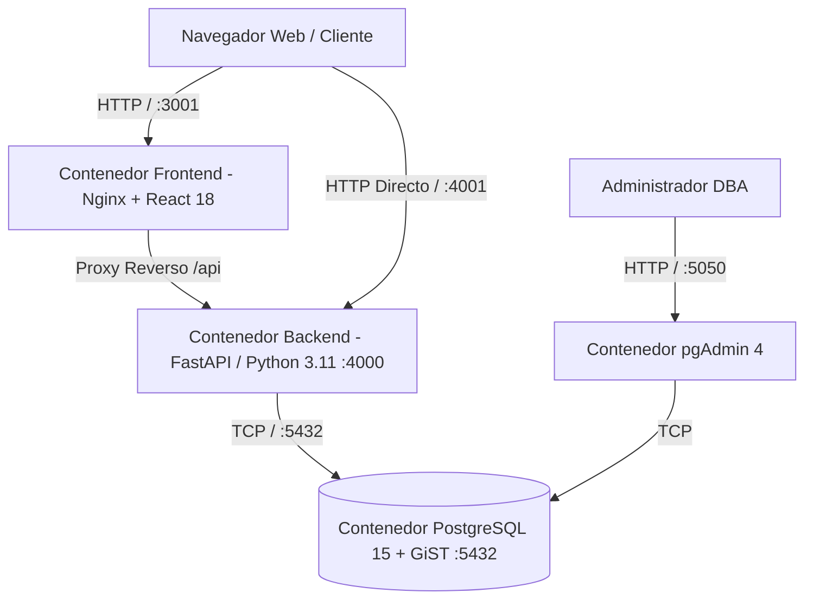
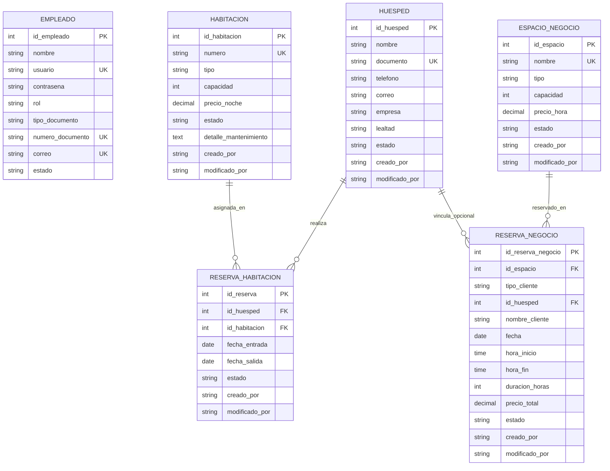

<!--
  ¿Qué? Documentación maestra y completa del proyecto BookingSoft (Apartahotel Facile).
  ¿Para qué? Proveer visión 360°, contexto arquitectural, técnico, de base de datos,
             seguridad y requerimientos para evaluación académica y contextualización en Gemini AI.
  ¿Impacto? Documento central de verdad del sistema. Garantiza la comprensión integral
             del estado del proyecto, su alcance actual y la base para futuras extensiones.
-->

# 🏨 BookingSoft — Sistema Integral de Gestión Hotelera (PMS)

> **Proyecto Formativo** — SENA | Centro de Formación en Tecnologías de la Información  
> **Programa:** Análisis y Desarrollo de Software (ADSO) | Convocatoria 2026  
> **Organización Destino:** Apartahotel Facile (Ibagué, Colombia)  
> **Licencia:** ISC | **Estado:** Fase 1 Consolidada y Probada en Docker

---

## 📑 Tabla de Contenidos

1. [🌟 Resumen Ejecutivo y Propósito del Proyecto](#-resumen-ejecutivo-y-propósito-del-proyecto)
2. [🏗️ Arquitectura del Sistema y Stack Tecnológico](#️-arquitectura-del-sistema-y-stack-tecnológico)
3. [📁 Estructura del Repositorio](#-estructura-del-repositorio)
4. [🚀 Despliegue y Arranque Rápido con Docker](#-despliegue-y-arranque-rápido-con-docker)
5. [⚙️ Variables de Entorno y Configuración](#️-variables-de-entorno-y-configuración)
6. [🗄️ Modelo de Base de Datos y Lógica Relacional](#️-modelo-de-base-de-datos-y-lógica-relacional)
7. [🛡️ Seguridad, Autenticación y Matriz RBAC](#️-seguridad-autenticación-y-matriz-rbac)
8. [🔌 Catálogo Completo de Endpoints REST (API)](#-catálogo-completo-de-endpoints-rest-api)
9. [💼 Reglas de Negocio y Lógica Hotelera](#-reglas-de-negocio-y-lógica-hotelera)
10. [💻 Frontend: Experiencia de Huésped y PMS Operativo](#-frontend-experiencia-de-huésped-y-pms-operativo)
11. [👥 Cuentas Semilla y Credenciales de Prueba](#-cuentas-semilla-y-credenciales-de-prueba)
12. [🧪 Pruebas Automatizadas y Verificación de Persistencia](#-pruebas-automatizadas-y-verificación-de-persistencia)
13. [📊 Matriz de Requisitos (RF, RNF, HU y Estado de Alcance)](#-matriz-de-requisitos-rf-rnf-hu-y-estado-de-alcance)
14. [🤖 Contexto Maestro para Inyección en Modelos LLM (Gemini AI)](#-contexto-maestro-para-inyección-en-modelos-llm-gemini-ai)
15. [👥 Equipo de Desarrollo](#-equipo-de-desarrollo)

---

## 🌟 Resumen Ejecutivo y Propósito del Proyecto

**BookingSoft** es una solución informática integral tipo **PMS (Property Management System)** y motor de reservas web desarrollada a la medida para el **Apartahotel Facile**.

El establecimiento combina la modalidad de apartahotel de estancias cortas y prolongadas con servicios corporativos de **Centro de Negocios (Salas de Juntas y Coworking)**.

### Objetivos Clave Alcanzados:

- **Prevención Matemática de Doble Reserva (Double-Booking):** Implementación a nivel de motor de base de datos con restricciones de exclusión `GiST` en rangos temporales continuos, eliminando cualquier condición de carrera concurrente.
- **Control de Acceso Basado en Roles (RBAC):** Separación estricta de responsabilidades entre Administrador, Recepcionistas, Ama de Llaves y Mantenimiento.
- **Gestión Dual de Negocio:** Coexistencia de reservas nocturnas de habitaciones y reservas por bloques de horas para salas de reuniones y coworking.
- **Alta Disponibilidad y Persistencia:** Infraestructura contenerizada orquestada mediante Docker Compose con comprobaciones de salud encadenadas (`healthchecks`).
- **Arquitectura Limpia y Auditable:** Trazabilidad obligatoria (`creado_por`, `modificado_por`) y política de bajas lógicas (soft delete) en todas las entidades transaccionales.

---

## 🏗️ Arquitectura del Sistema y Stack Tecnológico

El proyecto implementa una arquitectura desacoplada cliente-servidor distribuida en 4 contenedores independientes:



### Componentes Tecnológicos:

| Capa                    | Componente        | Versión / Tecnologías             | Detalle Técnico                                                           |
| :---------------------- | :---------------- | :-------------------------------- | :------------------------------------------------------------------------ |
| **Backend**             | Python / FastAPI  | Python 3.11, FastAPI, Pydantic v2 | API REST asíncrona modular, lifespan events, fail-fast de seguridad.      |
| **Seguridad Backend**   | PyJWT & bcrypt    | PyJWT >= 2.13, bcrypt (cost 12)   | Tokens stateless Bearer, expiración de 8h, hashing seguro.                |
| **Base de Datos**       | PostgreSQL Alpine | PostgreSQL 15-Alpine              | Extensión `btree_gist`, tipos de rango `daterange`, triggers PL/pgSQL.    |
| **Pool de Conexiones**  | Psycopg2          | `ThreadedConnectionPool` (1 a 20) | Reutilización eficiente de conexiones a nivel de hilo.                    |
| **Frontend**            | React SPA         | React 18, Vite 5.4, JS ES2022     | Interfaz responsiva con componentes nativos, CSS tokens y `lucide-react`. |
| **Web Server Frontend** | Nginx Alpine      | Nginx 1.25+                       | Servidor de estáticos y proxy reverso hacia el backend.                   |
| **Administración DB**   | pgAdmin 4         | dpage/pgadmin4                    | Consola visual web para administración y auditoría de la base de datos.   |
| **Contenedores**        | Docker Compose    | Compose v2.20+                    | Orquestación con volúmenes persistentes y dependencias con healthcheck.   |
| **Testing**             | Pytest            | pytest 8.x + HTTPX TestClient     | 15 pruebas de integración sobre PostgreSQL real sin mocks.                |

---

## 📁 Estructura del Repositorio

```text
bookingsoft_final/
├── .env.example                     # Plantilla estandarizada de variables de entorno
├── docker-compose.yml               # Orquestación de 4 servicios: db, backend, frontend, pgadmin
├── README.md                        # Documentación maestra integral (este documento)
├── test_persistence.sh             # Script Bash para prueba de fuego de persistencia
├── docs/                            # Documentación de ingeniería y requisitos
│   ├── MATRIZ_ROLES_ENDPOINTS.md   # Matriz exhaustiva RBAC por endpoint y método
│   ├── AUDITORIA_DEPENDENCIAS.md    # Reporte de seguridad pip-audit y pnpm audit
│   ├── ROTACION_SECRETOS.md         # Procedimiento de rotación de credenciales
│   ├── DESVIACION_NOMENCLATURA.md   # Justificación del estándar de código en español
│   └── requisitos/                  # Especificación detallada SENA
│       ├── MATRIZ_TRAZABILIDAD.md   # Trazabilidad RF vs HU vs Endpoint vs Tests
│       ├── restricciones.md         # Restricciones técnicas, de seguridad y metodológicas
│       ├── RFs/                     # Requisitos Funcionales individuales (RF-001 al RF-015)
│       ├── RNFs/                    # Requisitos No Funcionales (RNF-001 al RNF-011)
│       └── HUs/                     # Historias de Usuario (HU-001 al HU-015)
├── backend/                         # Código fuente del Servidor REST FastAPI
│   ├── Dockerfile                   # Imagen base python:3.11-slim
│   ├── Pipfile / Pipfile.lock       # Dependencias declaradas (Pipenv)
│   ├── main.py                      # Instancia FastAPI, CORS, lifespan y Fail-Fast JWT
│   ├── dependencies.py              # Guardas de seguridad: autenticar, requiere_rol
│   ├── schema.sql                   # Esquema DDL + Funciones + Triggers + Seed Data
│   ├── database/
│   │   └── connection.py            # Pool de conexiones PostgreSQL parametrizado
│   ├── models/
│   │   └── schemas.py               # Contratos Pydantic v2 (Input validation)
│   ├── routes/                      # Controladores modulares por dominio
│   │   ├── auth.py                  # Login, registro y validación de tokens
│   │   ├── empleados.py             # CRUD y gestión de estados de empleados
│   │   ├── huespedes.py             # Directorio de huéspedes y auth cliente
│   │   ├── habitaciones.py          # Gestión y cambio de estado de habitaciones
│   │   ├── reservas.py              # Creación atómica y cancelación de reservas
│   │   └── centro_negocios.py       # Salas de juntas y coworking por horas
│   └── tests/                       # Suite automatizada de pruebas
│       ├── conftest.py              # Fixtures de Pytest (cliente HTTP, tokens seed)
│       ├── test_auth.py             # Pruebas de login, registro, RBAC y firma JWT
│       ├── test_consultas.py        # Pruebas de listados, filtros y estados
│       └── test_reservas.py         # Pruebas de GiST double-booking y descuentos
└── frontend/                        # Cliente Web SPA en React
    ├── Dockerfile                   # Multi-stage build (Node build -> Nginx Alpine)
    ├── nginx.conf                   # Configuración de Nginx y proxy pass
    ├── package.json                 # Dependencias Node (React 18, Vite 5, Lucide)
    └── src/
        ├── main.jsx                 # Punto de entrada de React en el DOM
        ├── index.css                # Sistema de diseño con CSS tokens y estilos modernos
        └── App.jsx                  # SPA completa (Portal Huésped + Suite PMS)
```

---

## 🚀 Despliegue y Arranque Rápido con Docker

El sistema se encuentra empaquetado para levantar en cualquier máquina con Docker sin requerir instalación previa de Python ni Node.js.

### 1. Clonación y preparación de entorno

```bash
git clone https://github.com/bookingsoftHOTELFACILE/PROYECTO_FACILE.git
cd PROYECTO_FACILE
git checkout develop
```

### 2. Configurar el archivo de entorno

```bash
cp .env.example .env
```

> ⚠️ **Importante:** Configure un secreto seguro en `JWT_SECRET` (mínimo 32 caracteres) y defina contraseñas válidas. Si `JWT_SECRET` contiene `CHANGE_ME`, el backend abortará por diseño (Fail-Fast).

### 3. Construcción y levantamiento de los servicios

```bash
docker compose up --build -d
```

### 4. Puertos y Servicios Disponibles en Host

| Servicio                                | URL / Puerto                                                 | Credenciales por Defecto                   |
| :-------------------------------------- | :----------------------------------------------------------- | :----------------------------------------- |
| **Frontend Web (Huéspedes + PMS)**      | [http://localhost:3001](http://localhost:3001)               | N/A                                        |
| **Backend REST API (Salud)**            | [http://localhost:4001/health](http://localhost:4001/health) | N/A                                        |
| **Documentación Interactiva (Swagger)** | [http://localhost:4001/docs](http://localhost:4001/docs)     | N/A                                        |
| **Documentación ReDoc**                 | [http://localhost:4001/redoc](http://localhost:4001/redoc)   | N/A                                        |
| **PostgreSQL (Acceso directo)**         | `localhost:5433`                                             | Usuario: `adso_user` (Ver `.env`)          |
| **pgAdmin 4 (Administración Web DB)**   | [http://localhost:5050](http://localhost:5050)               | Email: `admin@admin.com` \| Clave: `admin` |

### 5. Reinicio Limpio de Base de Datos (Opcional)

Para vaciar la base de datos y recrear el esquema con el sembrado inicial:

```bash
docker compose down -v
RESET_DB=true docker compose up --build -d
```

---

## ⚙️ Variables de Entorno y Configuración

El archivo `.env` en la raíz controla la parametrización de toda la plataforma:

```ini
# Contenedor PostgreSQL
POSTGRES_USER=adso_user
POSTGRES_PASSWORD=adso_password_segura_2026
POSTGRES_DB=bookingsoft

# Parámetros de conexión para Backend (Docker interno)
DB_HOST=db
DB_PORT=5432
DB_USER=adso_user
DB_PASSWORD=adso_password_segura_2026
DB_NAME=bookingsoft

# Parámetros de Servidor Backend
PORT=4000
JWT_SECRET=super_secreto_jwt_bookingsoft_seguro_2026_facile

# Configuración de inicialización
RESET_DB=false

# Configuración CORS
CORS_ORIGINS=http://localhost:3000,http://localhost:3001,http://127.0.0.1:3000,http://127.0.0.1:3001
```

---

## 🗄️ Modelo de Base de Datos y Lógica Relacional

El motor de persistencia es PostgreSQL 15 con el dialecto DDL estructurado en `backend/schema.sql`.

### Entidades Principales



### Características Técnicas del Esquema:

1. **Exclusión GiST para Doble Reserva (RF-011):**

   ```sql
   CREATE EXTENSION IF NOT EXISTS btree_gist;

   CONSTRAINT exclude_overlapping_reservations EXCLUDE USING gist (
       id_habitacion WITH =,
       daterange(fecha_entrada, fecha_salida) WITH &&
   ) WHERE (estado IN ('Confirmada', 'Check-In'));
   ```

   _Efecto:_ Impide a nivel de bloques en disco que dos transacciones concurrentes aparten la misma habitación en fechas solapadas. Si ocurre, la base de datos lanza un error `23P01 (exclusion_violation)` que la API transforma en HTTP `409 Conflict`.

2. **Trigger de Bloqueo por Mantenimiento:**
   La función `fn_validar_double_booking()` dispara una excepción si se intenta reservar una habitación marcada como `'Mantenimiento'`.

3. **Cálculo de Estadía y Descuento por Larga Estancia:**
   La función PL/pgSQL `fn_calcular_noches_y_precio()` calcula el importe total y deduce automáticamente un **15% de descuento** si la estadía supera las 15 noches.

4. **Auditoría Transaccional:**
   Todas las tablas maestras incorporan `creado_por` y `modificado_por`, registrando la firma del usuario y rol que originó el cambio.

---

## 🛡️ Seguridad, Autenticación y Matriz RBAC

BookingSoft aplica el principio de mínimo privilegio mediante dependencias inyectables de FastAPI:

- **Fail-Fast de Arranque:** Si `JWT_SECRET` no está establecido, el servidor aborta antes de abrir el socket de red.
- **Cifrado Robusto:** Contraseñas hasheadas con `bcrypt` (12 rondas de salting).
- **Protección contra Fuerza Bruta / Enumeración:** Respuestas homogéneas en fallos de autenticación (_"Credenciales incorrectas"_).
- **Inhabilitación Efectiva:** Un usuario con `estado = 'Inactivo'` tiene denegado el login aun cuando su contraseña coincida.

### Matriz de Acceso por Roles (RBAC)

| Endpoint                             |  Método  | Acción Funcional                  | Público | Admin | Recepción 24h | Ama de Llaves | Mantenimiento |
| :----------------------------------- | :------: | :-------------------------------- | :-----: | :---: | :-----------: | :-----------: | :-----------: |
| `/api/auth/login`                    |  `POST`  | Iniciar sesión y obtener JWT      |   ✅    |  ✅   |      ✅       |      ✅       |      ✅       |
| `/api/auth/registro`                 |  `POST`  | Registrar nuevo empleado          |   ❌    |  ✅   |      ❌       |      ❌       |      ❌       |
| `/api/empleados`                     |  `GET`   | Listar nómina de empleados        |   ❌    |  ✅   |      ❌       |      ❌       |      ❌       |
| `/api/empleados/{id}`                |  `GET`   | Consultar empleado por ID         |   ❌    |  ✅   |      ❌       |      ❌       |      ❌       |
| `/api/empleados/{id}/rol`            | `PATCH`  | Reasignar rol a empleado          |   ❌    |  ✅   |      ❌       |      ❌       |      ❌       |
| `/api/empleados/{id}/estado`         | `PATCH`  | Activar/Desactivar empleado       |   ❌    |  ✅   |      ❌       |      ❌       |      ❌       |
| `/api/huespedes`                     |  `GET`   | Consultar directorio de huéspedes |   ❌    |  ✅   |      ✅       |      ❌       |      ❌       |
| `/api/user/registro`                 |  `POST`  | Registrar huésped (Público/PMS)   |   ✅    |  ✅   |      ✅       |      ❌       |      ❌       |
| `/api/huespedes/{id}/estado`         | `PATCH`  | Modificar estado de huésped       |   ❌    |  ✅   |      ✅       |      ❌       |      ❌       |
| `/api/huespedes/{id}`                | `DELETE` | Baja lógica de huésped            |   ❌    |  ✅   |      ❌       |      ❌       |      ❌       |
| `/api/habitaciones`                  |  `GET`   | Consultar estado de habitaciones  |   ❌    |  ✅   |      ✅       |      ✅       |      ✅       |
| `/api/habitaciones`                  |  `POST`  | Dar de alta nueva unidad          |   ❌    |  ✅   |      ❌       |      ❌       |      ❌       |
| `/api/habitaciones/{id}`             |  `PUT`   | Actualizar capacidad o tarifas    |   ❌    |  ✅   |      ❌       |      ❌       |      ❌       |
| `/api/habitaciones/{id}/estado`      | `PATCH`  | Cambiar estado de habitación      |   ❌    |  ✅   |      ✅       |      ✅       |      ✅       |
| `/api/habitaciones/{id}`             | `DELETE` | Inactivar habitación              |   ❌    |  ✅   |      ❌       |      ❌       |      ❌       |
| `/api/reservas`                      |  `GET`   | Listar reservas activas           |   ❌    |  ✅   |      ✅       |      ❌       |      ❌       |
| `/api/reservas`                      |  `POST`  | Crear reserva atómica (GiST)      |   ❌    |  ✅   |      ✅       |      ❌       |      ❌       |
| `/api/reservas/{id}/estado`          | `PATCH`  | Cambiar estado de reserva         |   ❌    |  ✅   |      ✅       |      ❌       |      ❌       |
| `/api/reservas/{id}`                 | `DELETE` | Cancelar reserva (baja lógica)    |   ❌    |  ✅   |      ✅       |      ❌       |      ❌       |
| `/api/centro-negocios/espacios`      |  `GET`   | Listar salas y coworking          |   ✅    |  ✅   |      ✅       |      ✅       |      ✅       |
| `/api/centro-negocios/reservas`      |  `GET`   | Listar reservas de negocio        |   ✅    |  ✅   |      ✅       |      ✅       |      ✅       |
| `/api/centro-negocios/reservas`      |  `POST`  | Reservar sala/coworking           |   ✅    |  ✅   |      ✅       |      ✅       |      ✅       |
| `/api/centro-negocios/reservas/{id}` | `DELETE` | Cancelar reserva de negocio       |   ✅    |  ✅   |      ✅       |      ✅       |      ✅       |
| `/health`                            |  `GET`   | Diagnóstico de salud API y DB     |   ✅    |  ✅   |      ✅       |      ✅       |      ✅       |

---

## 🔌 Catálogo Completo de Endpoints REST (API)

La API expone **24 endpoints REST** con serialización estricta mediante modelos Pydantic v2.

### 1. Módulo de Autenticación (`/api/auth`)

- `POST /api/auth/login`: Recibe `{usuario, contrasena}` y retorna `{access_token, token_type: "bearer"}`.
- `POST /api/auth/registro`: Exclusivo de Administrador. Crea nuevos usuarios con validación de documentos y correos únicos.

### 2. Módulo de Empleados (`/api/empleados`)

- `GET /api/empleados`: Retorna la lista de empleados sin exponer el hash de contraseña.
- `GET /api/empleados/{id}`: Detalle de un empleado específico.
- `PATCH /api/empleados/{id}/rol`: Permite actualizar el rol operativo.
- `PATCH /api/empleados/{id}/estado`: Alterna estado entre `'Activo'` e `'Inactivo'`.

### 3. Módulo de Huéspedes (`/api/huespedes` y `/api/user`)

- `GET /api/huespedes`: Directorio con nivel de lealtad (`Silver`, `Gold`, `Platinum`).
- `POST /api/user/registro`: Registro de huésped con documento de identidad y contacto.
- `PATCH /api/huespedes/{id}/estado`: Habilita o inhabilita huéspedes.
- `DELETE /api/huespedes/{id}`: Baja lógica (`estado = 'Inactivo'`).
- `POST /api/user/guest-login`: Acceso simplificado para huéspedes recurrentes.
- `POST /api/user/guest-recuperar`: Solicitud de recuperación de credenciales de huésped.
- `POST /api/user/guest-restablecer`: Restablecimiento de contraseña de portal de huésped.

### 4. Módulo de Habitaciones (`/api/habitaciones`)

- `GET /api/habitaciones`: Inventario físico con estado actual (`Disponible`, `Ocupada`, `En limpieza`, `Mantenimiento`).
- `POST /api/habitaciones`: Alta de habitación con capacidad y tarifa por noche.
- `PUT /api/habitaciones/{id}`: Actualización de metadatos de la unidad.
- `PATCH /api/habitaciones/{id}/estado`: Cambio de estado operativo (usado por Ama de Llaves para liberar habitaciones y por Mantenimiento para registrar averías).
- `DELETE /api/habitaciones/{id}`: Baja lógica de la unidad habitacional.

### 5. Módulo de Reservas de Habitaciones (`/api/reservas`)

- `GET /api/reservas`: Retorna reservas activas con datos del huésped y habitación asociada.
- `POST /api/reservas`: Generación de reserva con validación de capacidad y bloqueo atómico GiST.
- `PATCH /api/reservas/{id}/estado`: Transición de estado (`Confirmada` → `Check-In` → `Completada`).
- `DELETE /api/reservas/{id}`: Cancelación de reserva con baja lógica (`estado = 'Cancelada'`), liberando automáticamente el rango GiST para futuras reservas.

### 6. Módulo de Centro de Negocios (`/api/centro-negocios`)

- `GET /api/centro-negocios/espacios`: Listado de salas de juntas y puestos de coworking con tarifa por hora.
- `GET /api/centro-negocios/reservas`: Consulta de agenda activa de salas y puestos.
- `POST /api/centro-negocios/reservas`: Creación de reserva con validación horaria de no solapamiento y cálculo automático de paquetes por horas (descuentos a partir de 4 y 8 horas).
- `DELETE /api/centro-negocios/reservas/{id}`: Cancelación con baja lógica.

### 7. Diagnóstico de Infraestructura

- `GET /health`: Monitoreo del estado de conexión activa hacia PostgreSQL.

---

## 💼 Reglas de Negocio y Lógica Hotelera

1. **Catálogo Oficial de Alojamientos:**
   - 38 unidades habitacionales operativas:
     - **14 Dúplex:** Capacidad de 3 personas, tarifa base $250.000 COP/noche.
     - **11 Dobles:** Capacidad de 4 personas, tarifa base $350.000 COP/noche.
     - **2 Familiares:** Capacidad de 6 personas, tarifa base $450.000 COP/noche.
     - **11 Habitaciones Estándar:** Capacidad de 2 personas, tarifa base $180.000 COP/noche.
2. **Validación de Capacidad:**
   El número de personas indicado en una reserva no puede superar la capacidad máxima de la unidad habitacional (Regla de Negocio RN-011.4).
3. **Descuento de Larga Estancia:**
   Reservas mayores a 15 noches reciben una bonificación automática del 15% sobre el total liquidado.
4. **Ciclo de Estados de Habitación:**
   `Disponible` ➔ `Ocupada` (Check-In) ➔ `En limpieza` (Check-Out) ➔ `Disponible` (Ama de Llaves). Las habitaciones con daños transicionan a `Mantenimiento` bloqueando nuevas reservas.
5. **Políticas de Centro de Negocios:**
   - Horarios entre 07:00 y 20:00.
   - Paquetes especiales para Salas de Juntas: 4 horas ($250.000 COP) y 8 horas ($450.000 COP).
   - Paquetes para Coworking Flex: 4 horas ($70.000 COP) y día completo ($100.000 COP).

---

## 💻 Frontend: Experiencia de Huésped y PMS Operativo

El frontend es una **Single Page Application (SPA)** reactiva construida en React 18, estructurada en dos grandes experiencias de usuario:

### 1. Portal Público de Huéspedes

- **Pestaña Inicio:** Hero promocional, propuesta de valor de Apartahotel Facile y accesos directos.
- **Pestaña Apartamentos:** Catálogo interactivo de las 38 unidades con filtros por tipología, comodidades, capacidad y galería fotográfica.
- **Pestaña Centro de Negocios:** Presentación de salas de juntas y espacios coworking con cotizador en tiempo real por horas.
- **Pestaña Servicios:** Detalle de amenidades (estacionamiento, recepción 24h, wifi de alta velocidad, cocinas equipadas, lavandería).
- **Pestaña Galería:** Visor fotográfico organizado por categorías.
- **Pestaña Reservar:** Motor de reserva en línea paso a paso con cálculo de tarifas y validación de disponibilidad.

### 2. Suite PMS (Property Management System) Interna

Acceso mediante botón superior con validación JWT, organizado en sub-pestañas operativas según el rol autenticado:

- 👑 **Personal & Roles (Solo Administrador):** Registro de nuevos empleados, visualización de nómina y conmutación de estados y roles.
- 🛎️ **Recepción (Walk-in):** Registro express de huéspedes y generación inmediata de reservas de mostrador.
- 📋 **Huéspedes:** Listado maestro de clientes con categorización de fidelidad y gestión de estado.
- 📅 **Reservas:** Gestión del calendario de reservas de habitaciones, cambio de estados operativos y cancelación.
- 🧹 **Planta (Ama de Llaves & Mantenimiento):** Tablero visual tipo semáforo con el estado de cada habitación, permitiendo a las camareras liberar habitaciones tras el aseo y al personal técnico registrar detalles de averías.
- 💼 **Coworking:** Calendario y control de reservas de espacios de trabajo y salas ejecutivas.
- 📊 **Todos:** Vista global unificada para gerencia y auditoría general.

---

## 👥 Cuentas Semilla y Credenciales de Prueba

El archivo `schema.sql` aprovisiona credenciales cifradas con bcrypt para validación funcional de cada perfil RBAC:

| Usuario         | Contraseña         | Rol en el Sistema             | Vista / Sub-pestaña por Defecto        |
| :-------------- | :----------------- | :---------------------------- | :------------------------------------- |
| `admin`         | `adminpassword123` | **Administrador**             | 👑 Personal & Roles (Acceso total)     |
| `recepcion`     | `recepcion123`     | **Recepcionista 24h**         | 🛎️ Recepción y reservas walk-in        |
| `amallaves`     | `amallaves123`     | **Ama de llaves**             | 🧹 Planta (Solo aseo y disponibilidad) |
| `mantenimiento` | `mantenimiento123` | **Personal de mantenimiento** | 🔧 Planta (Bitácora de mantenimiento)  |

> ⚠️ **Aviso de Entorno Educativo:** Estas contraseñas son de uso público para revisión docente del SENA y pruebas de integración locales. En un despliegue de producción deben cambiarse mediante el script de rotación de secretos.

---

## 🧪 Pruebas Automatizadas y Verificación de Persistencia

### Suite de Integración con Pytest

El sistema cuenta con **15 pruebas automatizadas de integración** que se ejecutan directamente sobre una instancia real de PostgreSQL (sin simulación ni base de datos en memoria):

```bash
# Ejecutar la suite completa dentro del contenedor backend
docker compose exec backend pytest -v
```

#### Cobertura de las Pruebas:

1. `test_auth.py`:
   - `test_registro_exitoso`: Creación de empleado y verificación de hash bcrypt.
   - `test_registro_usuario_duplicado`: Rechazo por documento/correo duplicado.
   - `test_login_valido`: Generación de token JWT válido.
   - `test_login_credenciales_incorrectas`: Rechazo de credenciales erróneas.
   - `test_login_usuario_inactivo`: Bloqueo de login para usuarios con `estado = 'Inactivo'`.
   - `test_control_acceso_sin_token`: Denegación HTTP 401 en endpoints protegidos.
   - `test_control_acceso_rol_sin_permiso`: Denegación HTTP 403 por rol insuficiente.
   - `test_control_acceso_firma_manipulada`: Rechazo de tokens con firma inválida.
2. `test_consultas.py`:
   - `test_rf002_consulta_listado_empleados`: Listado de empleados por Admin.
   - `test_rf003_consulta_empleado_especifico`: Consulta de perfil por ID.
   - `test_recepcionista_gestion_rol_y_estado`: Validación de permisos de recepcionista.
   - `test_rf012_consulta_disponibilidad`: Filtrado de habitaciones disponibles.
3. `test_reservas.py`:
   - `test_reserva_descuento`: Aplicación del 15% de descuento en estancias > 15 noches.
   - `test_reserva_supera_capacidad`: Rechazo cuando el aforo supera la capacidad de la habitación.
   - `test_reserva_concurrencia_double_booking`: Validación del constraint de exclusión GiST ante dos intentos concurrentes de reservar las mismas fechas.

### Prueba de Persistencia Física ante Reinicio de Contenedores

El proyecto incluye un script de validación real de persistencia en disco:

```bash
chmod +x test_persistence.sh
./test_persistence.sh
```

El script genera una reserva, apaga de forma abrupta el contenedor de backend (`docker compose stop backend`), vuelve a encenderlo (`docker compose start backend`) y verifica que los registros persistan intactos en el volumen de PostgreSQL.

---

## 📊 Matriz de Requisitos (RF, RNF, HU y Estado de Alcance)

| Código     | Requisito                         | HU     | RNF     |  Estado Actual  | Justificación / Mecanismo                         |
| :--------- | :-------------------------------- | :----- | :------ | :-------------: | :------------------------------------------------ |
| **RF-001** | Registro de Empleados             | HU-001 | RNF-001 |   ✅ Probado    | `POST /api/auth/registro` (Admin)                 |
| **RF-002** | Consulta de Empleados             | HU-003 | RNF-009 |   ✅ Probado    | `GET /api/empleados`                              |
| **RF-003** | Consulta de Empleado Específico   | HU-004 | RNF-009 |   ✅ Probado    | `GET /api/empleados/{id}`                         |
| **RF-004** | Inicio de Sesión                  | HU-002 | RNF-001 |   ✅ Probado    | `POST /api/auth/login` (JWT)                      |
| **RF-005** | Cierre de Sesión                  | HU-002 | RNF-001 |   ✅ Probado    | Purga de Bearer token en cliente                  |
| **RF-006** | Modificación de Rol               | HU-004 | RNF-009 |   ✅ Probado    | `PATCH /api/empleados/{id}/rol`                   |
| **RF-007** | Validación de Credenciales        | HU-002 | RNF-001 |   ✅ Probado    | Verificación segura contra timing attacks         |
| **RF-008** | Cifrado de Contraseñas            | HU-001 | RNF-005 |   ✅ Probado    | `bcrypt` cost factor 12                           |
| **RF-009** | Control de Acceso (RBAC)          | HU-002 | RNF-009 |   ✅ Probado    | Guardas `requiere_rol()`                          |
| **RF-010** | Gestión de Estado Activo/Inactivo | HU-004 | RNF-010 |   ✅ Probado    | Bajas lógicas y validación en login               |
| **RF-011** | Creación de Reserva Atómica       | HU-005 | RNF-009 |   ✅ Probado    | Constraint PostgreSQL `EXCLUDE USING gist`        |
| **RF-012** | Consulta de Disponibilidad        | HU-005 | RNF-011 |   ✅ Probado    | `GET /api/habitaciones` con estados               |
| **RF-013** | Modificación de Reserva           | HU-005 | N/A     |    ⏳ Fase 2    | Por integridad GiST, se cancela y recrea          |
| **RF-014** | Cancelación de Reserva            | HU-005 | RNF-010 |   ✅ Probado    | `DELETE /api/reservas/{id}` (Baja lógica)         |
| **RF-015** | Coworking y Salas de Juntas       | HU-013 | N/A     | ✅ Implementado | `routes/centro_negocios.py` con tarifas por horas |

### Funcionalidades Diferidas a Fase 2 (Alcance Delimitado):

- **HU-005 (Check-In / Check-Out Automatizado):** Integración con cerraduras inteligentes RFID/Bluetooth y entrega física de llaves.
- **HU-010 (Gestión Financiera Avanzada):** Facturación electrónica con la DIAN y pasarela de pago online (Wompi/PayU).
- **HU-012 (Notificaciones Automáticas):** Envío masivo de confirmaciones por SMS y WhatsApp Business API.

---

## 🤖 Contexto Maestro para Inyección en Modelos LLM (Gemini AI)

Si vas a abrir un nuevo chat o sesión con **Gemini**, puedes copiar y pegar el siguiente bloque resumen como tu mensaje inicial para transferirle de inmediato todo el contexto del proyecto:

```markdown
### CONTEXTO DEL PROYECTO PARA GEMINI:

- Nombre: BookingSoft (PMS y Motor de Reservas para Apartahotel Facile, Ibagué).
- Stack: FastAPI (Python 3.11), PostgreSQL 15 con btree_gist, React 18 (Vite 5.4, JS ES2022), Docker Compose, Nginx.
- Puertos en Docker: Frontend (3001), Backend (4001, interno 4000), DB (5433, interno 5432), pgAdmin (5050).
- Seguridad: JWT Bearer (8h), bcrypt cost 12, guardas RBAC ('Administrador', 'Recepcionista 24h', 'Ama de llaves', 'Personal de mantenimiento'), Fail-Fast si JWT_SECRET no existe.
- Regla Clave: Prevención de doble reserva a nivel DB mediante constraint GiST en reserva_habitacion (daterange &&), triggers de mantenimiento y cálculo automático de descuentos (15% para estancias >15 noches).
- Tablas Principales: empleado, huesped, habitacion (38 unidades oficiales), espacio_negocio, reserva_negocio (coworking por horas), reserva_habitacion. Todas con baja lógica y auditoría (creado_por, modificado_por).
- Frontend: Single Page Application con doble modo: Portal de Huéspedes público (Inicio, Apartamentos, Centro de Negocios, Servicios, Galería, Reservar) y Suite PMS para empleados (sub-pestañas: Personal, Recepción Walk-in, Huéspedes, Reservas, Planta, Coworking, Todos).
- Tests: 15 tests en pytest con PostgreSQL real (no mocks) y test_persistence.sh para comprobar supervivencia ante caída de contenedores.
- Estado: Fase 1 completa y probada. Listo para abordar nuevas funcionalidades de Fase 2.
```

---

## 👥 Equipo de Desarrollo

Proyecto desarrollado como parte de la formación profesional integral en **Análisis y Desarrollo de Software (ADSO)** — SENA, 2026:

| Integrante           | Rol / Especialidad                                   |
| :------------------- | :--------------------------------------------------- |
| **José Chico**       | Desarrollo Backend & Arquitectura de Base de Datos   |
| **Maicol Mayor**     | Lógica de Negocio & Pruebas Automatizadas            |
| **Ashly Echeverri**  | Documentación de Requisitos & Trazabilidad           |
| **Sebastián Parada** | Seguridad, RBAC & Contenedorización Docker           |
| **David López**      | Desarrollo Frontend & Experiencia de Usuario (UI/UX) |

---

_BookingSoft © 2026 — Apartahotel Facile. Todos los derechos reservados._
