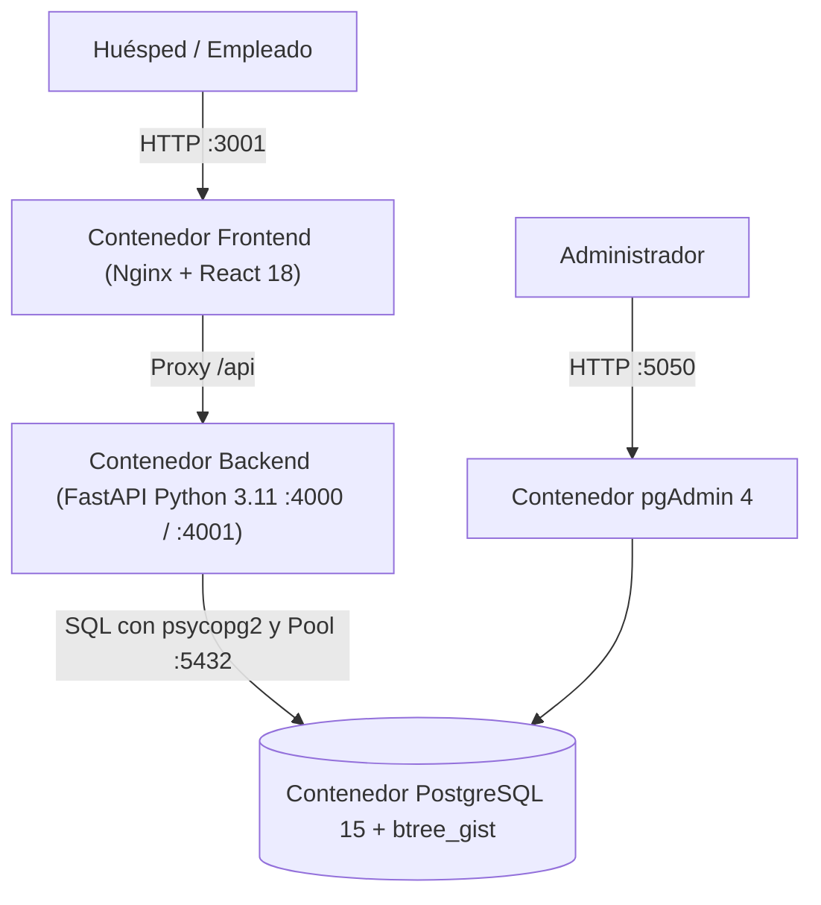
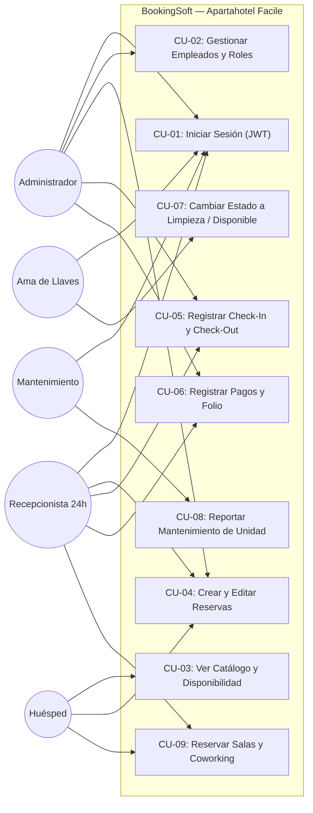
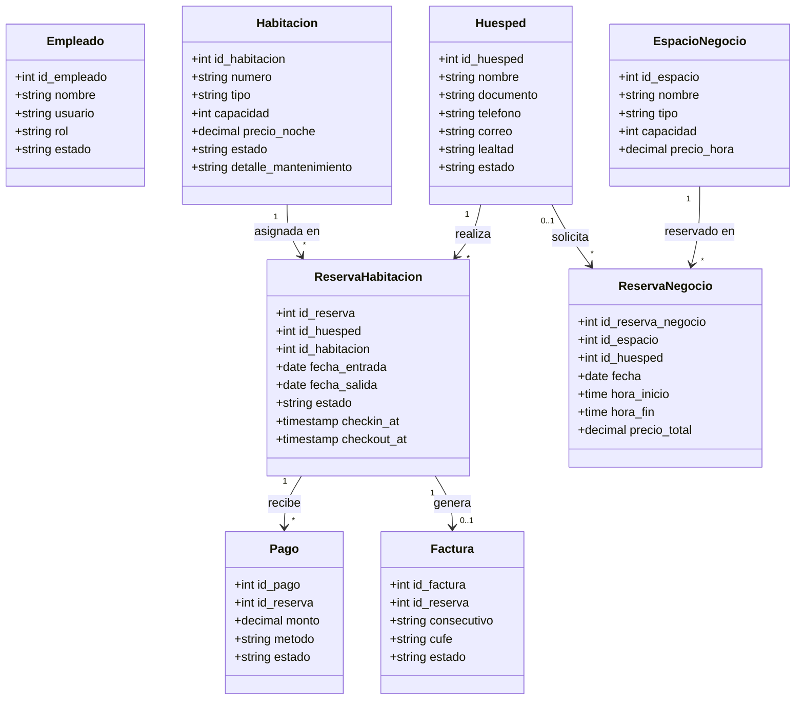
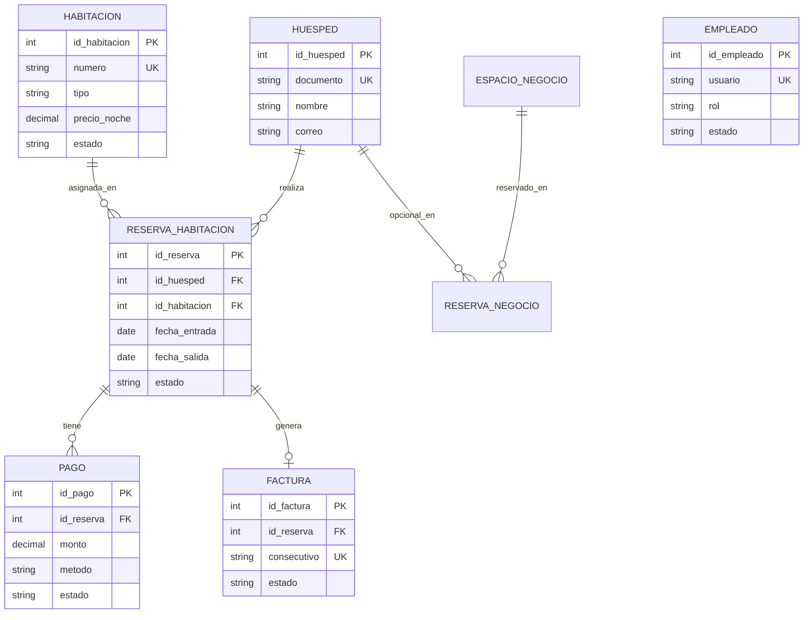
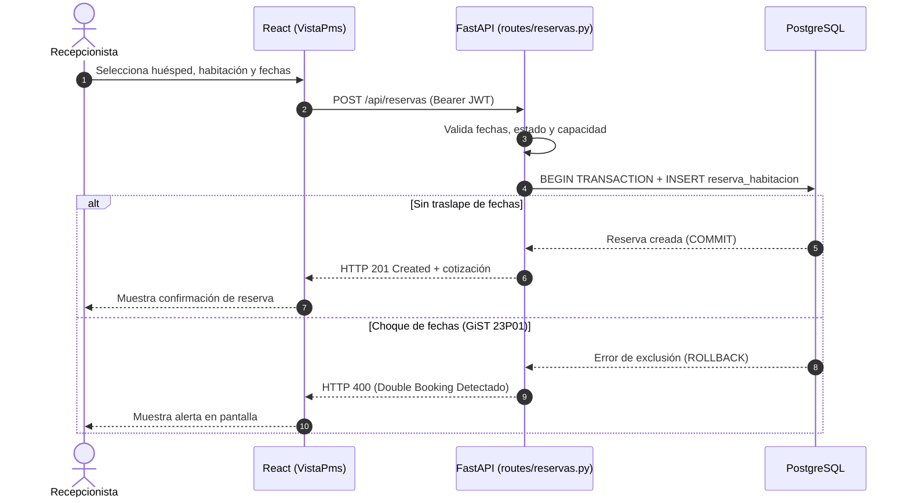

# Documentación General y Diagramas del Proyecto — BookingSoft

**Proyecto:** BookingSoft PMS — Apartahotel Facile  
**Programa:** Análisis y Desarrollo de Software (ADSO) — SENA  
**Autores:** David López, José Chico, Maicol Mayor, Sebastián Parada y Ashly Echeverri

---

## 1. Diagrama de Arquitectura del Sistema (Criterio 5)

Trabajamos una arquitectura cliente-servidor separada en contenedores con **Docker Compose**:

---

## 2. Diagrama de Casos de Uso (UML)

---

## 3. Diagrama de Clases del Dominio (UML)

---

## 4. Modelo Entidad-Relación (MER) y Modelo Relacional Real (`backend/schema.sql`)

### Tablas Reales en PostgreSQL (3FN):
1. **`empleado`**: `id_empleado` (`SERIAL` PK), `nombre`, `usuario` (UNIQUE), `contrasena` (hash bcrypt), `rol`, `tipo_documento`, `numero_documento` (UNIQUE), `correo` (UNIQUE), `estado`.
2. **`huesped`**: `id_huesped` (`SERIAL` PK), `nombre`, `documento` (UNIQUE), `telefono`, `correo`, `password_hash`, `empresa`, `lealtad`, `estado`, `creado_por`, `modificado_por`.
3. **`habitacion`**: `id_habitacion` (`SERIAL` PK), `numero` (UNIQUE), `tipo`, `capacidad`, `precio_noche`, `estado` (`Disponible`, `Ocupada`, `En limpieza`, `Mantenimiento`), `detalle_mantenimiento`.
4. **`reserva_habitacion`**: `id_reserva` (`SERIAL` PK), `id_huesped` (FK), `id_habitacion` (FK), `fecha_entrada`, `fecha_salida`, `estado` (`Confirmada`, `Check-In`, `Completada`, `Cancelada`), `checkin_at`, `checkout_at`, `observaciones`. Incluye la restricción **`EXCLUDE USING gist`** para impedir doble reserva en fechas solapadas.
5. **`pago`**: `id_pago` (`SERIAL` PK), `id_reserva` (FK), `monto`, `metodo`, `estado`, `referencia`, `gateway`.
6. **`factura`**: `id_factura` (`SERIAL` PK), `id_reserva` (FK UNIQUE), `consecutivo` (UNIQUE), `cufe`, `estado`, `xml`.
7. **`espacio_negocio`**: `id_espacio` (`SERIAL` PK), `nombre` (UNIQUE), `tipo` (`Sala de Juntas`, `Coworking`), `capacidad`, `precio_hora`, `estado`.
8. **`reserva_negocio`**: `id_reserva_negocio` (`SERIAL` PK), `id_espacio` (FK), `tipo_cliente`, `id_huesped` (FK opcional), `nombre_cliente`, `fecha`, `hora_inicio`, `hora_fin`, `duracion_horas`, `precio_total`, `estado`.

---

## 5. Diagrama de Secuencia: Flujo de Reserva en Recepción

