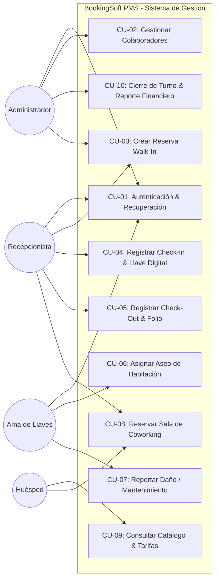
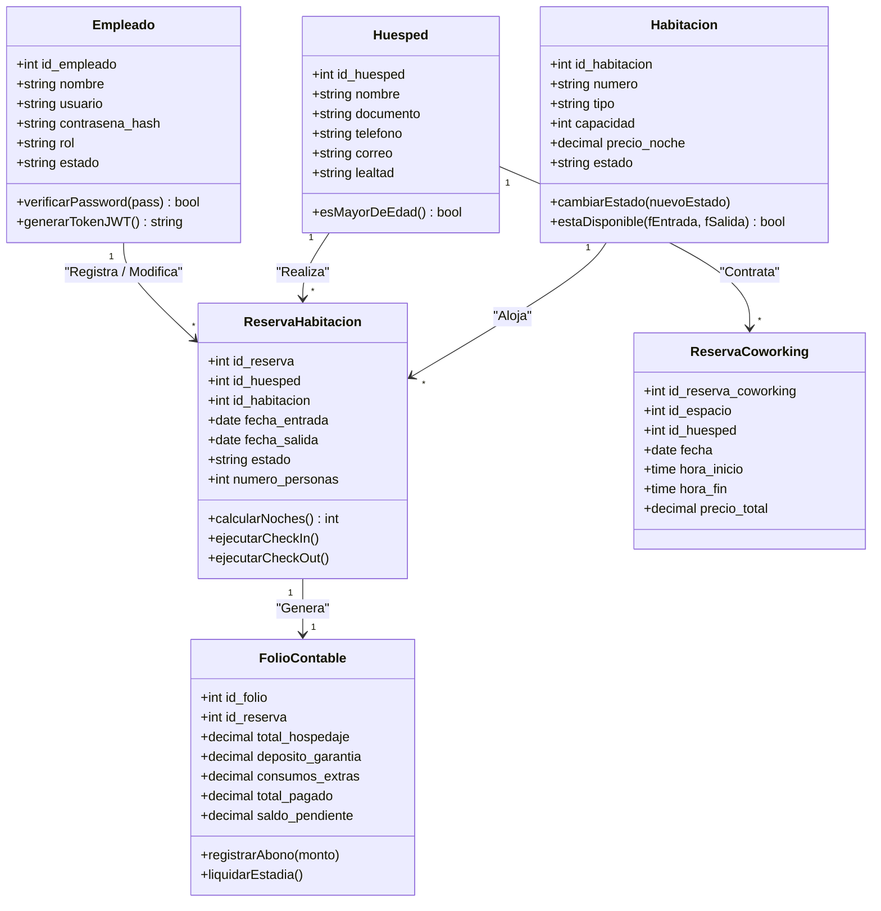
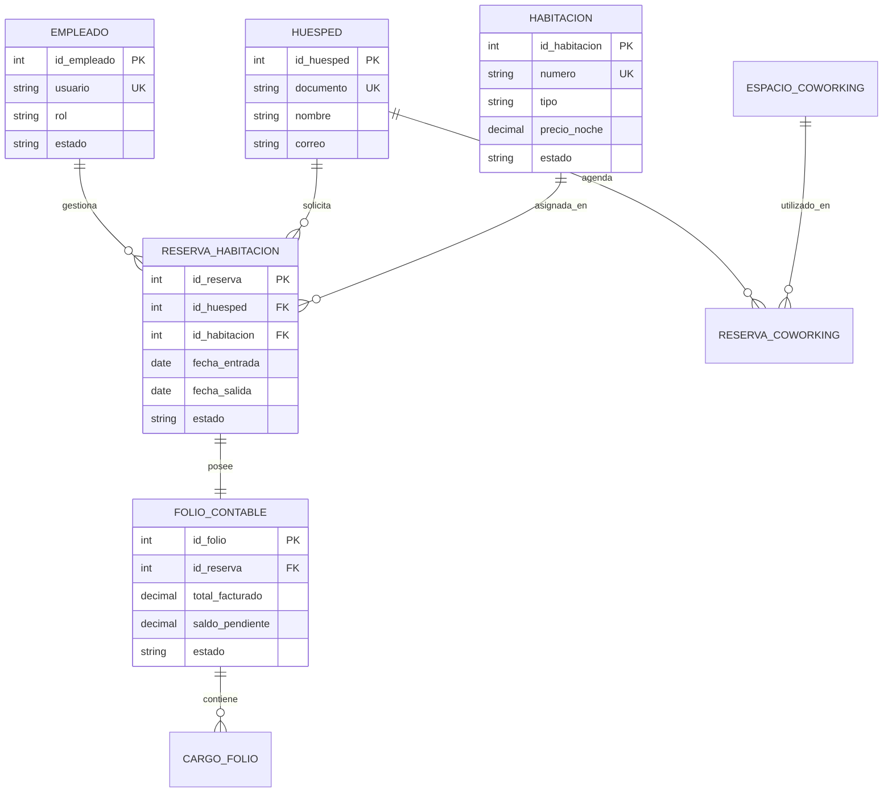
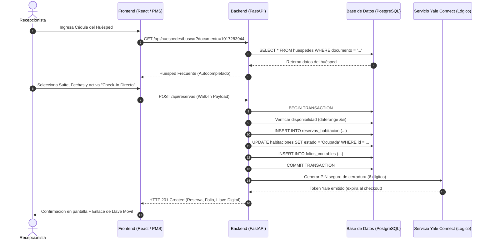

# 📐 Documentación General de Ingeniería de Software y Diagramas UML / MER / MR

**Proyecto:** BookingSoft PMS — Apartahotel Facile  
**Programa:** Análisis y Desarrollo de Software (ADSO) — SENA  
**Fecha:** Noviembre 2026  
**Autores:** Equipo de Desarrollo ADSO (Chico, Mayor, Echeverri, Parada, López)  

---

## 1. Diagrama de Arquitectura del Sistema (Criterio 5)

El sistema adopta una arquitectura desacoplada basada en microservicios orquestados mediante **Docker Compose**, asegurando alta disponibilidad, seguridad perimetral y aislamiento de red:

```mermaid
flowchart TD
    subgraph Cliente["Capa de Presentación (Frontend)"]
        User["Huésped / Recepcionista / Admin"] -->|HTTPS / HTTP :3001| Nginx["Nginx Reverse Proxy"]
        Nginx -->|Sirve SPA estática| ReactApp["React 18 + Vite SPA"]
    end

    subgraph Perimetro["Perímetro de Seguridad & Enrutamiento"]
        ReactApp -->|Peticiones /api/* (CORS + Bearer JWT)| APIGateway["FastAPI Gateway & Router :4000/:4001"]
    end

    subgraph Logica["Capa de Lógica de Negocio (Backend)"]
        APIGateway --> AuthModule["Módulo de Autenticación & RBAC"]
        APIGateway --> ReservasModule["Motor de Reservas & Disponibilidad"]
        APIGateway --> FolioModule["Módulo Contable & Liquidación COP"]
        APIGateway --> CoworkingModule["Módulo Centro de Negocios"]
        APIGateway --> MantenimientoModule["Módulo Ama de Llaves & Aseo"]
    end

    subgraph Persistencia["Capa de Persistencia de Datos"]
        AuthModule --> DBEngine["SQLAlchemy + ConnectionPool"]
        ReservasModule --> DBEngine
        FolioModule --> DBEngine
        CoworkingModule --> DBEngine
        MantenimientoModule --> DBEngine
        DBEngine -->|TCP :5432 / Protocolo Binario| Postgres[("PostgreSQL 15 (GiST + daterange)")]
    end

    subgraph Administracion["Monitoreo & Auditoría"]
        DBA["Administrador DBA"] -->|HTTP :5050| PgAdmin["pgAdmin 4"]
        PgAdmin --> Postgres
    end
```

---

## 2. Diagrama de Casos de Uso Global (UML)



---

## 3. Diagrama de Clases del Dominio (UML)



---

## 4. Modelo Entidad-Relación (MER) y Modelo Relacional (MR)

### 4.1 Modelo Entidad-Relación (ERD)



### 4.2 Modelo Relacional Normalizado (Tercera Forma Normal - 3FN)

A continuación se listan las tablas relacionales con sus restricciones de integridad referencial:

1. **`empleados`**  
   - `id_empleado` (INT, PK, AUTO_INCREMENT)  
   - `nombre` (VARCHAR(150), NOT NULL)  
   - `usuario` (VARCHAR(50), UK, NOT NULL)  
   - `contrasena` (VARCHAR(255), NOT NULL) — Hash Bcrypt  
   - `rol` (VARCHAR(50), NOT NULL) — `['Administrador', 'Recepcionista 24h', 'Ama de llaves', 'Personal de mantenimiento']`  
   - `tipo_documento` (VARCHAR(30), NOT NULL)  
   - `numero_documento` (VARCHAR(30), UK, NOT NULL)  
   - `correo` (VARCHAR(150), UK, NOT NULL)  
   - `estado` (VARCHAR(20), NOT NULL, DEFAULT 'Activo')  
   - `creado_en` (TIMESTAMP, DEFAULT NOW())

2. **`huespedes`**  
   - `id_huesped` (INT, PK, AUTO_INCREMENT)  
   - `nombre` (VARCHAR(150), NOT NULL)  
   - `tipo_documento` (VARCHAR(30), NOT NULL)  
   - `documento` (VARCHAR(30), UK, NOT NULL)  
   - `telefono` (VARCHAR(25), NOT NULL)  
   - `correo` (VARCHAR(150), NOT NULL)  
   - `empresa` (VARCHAR(150), NULL)  
   - `lealtad` (VARCHAR(20), DEFAULT 'Estandar')  
   - `estado` (VARCHAR(20), DEFAULT 'Activo')  
   - `creado_por` (VARCHAR(50))  
   - `modificado_por` (VARCHAR(50))

3. **`habitaciones`**  
   - `id_habitacion` (INT, PK, AUTO_INCREMENT)  
   - `numero` (VARCHAR(10), UK, NOT NULL)  
   - `tipo` (VARCHAR(50), NOT NULL) — `['Dúplex', 'Dobles', 'Familiares', 'Habitaciones']`  
   - `capacidad` (INT, NOT NULL)  
   - `precio_noche` (NUMERIC(12, 2), NOT NULL)  
   - `estado` (VARCHAR(25), NOT NULL, DEFAULT 'Disponible') — `['Disponible', 'Ocupada', 'Limpieza', 'Mantenimiento']`  
   - `detalle_mantenimiento` (TEXT, NULL)

4. **`reservas_habitacion`**  
   - `id_reserva` (INT, PK, AUTO_INCREMENT)  
   - `id_huesped` (INT, FK ➔ `huespedes.id_huesped`, NOT NULL)  
   - `id_habitacion` (INT, FK ➔ `habitaciones.id_habitacion`, NOT NULL)  
   - `fecha_entrada` (DATE, NOT NULL)  
   - `fecha_salida` (DATE, NOT NULL)  
   - `numero_personas` (INT, NOT NULL, DEFAULT 1)  
   - `estado` (VARCHAR(25), NOT NULL, DEFAULT 'Confirmada') — `['Confirmada', 'Check-In', 'Check-Out', 'Cancelada']`  
   - *Constraint:* `CHECK (fecha_salida > fecha_entrada)`  
   - *Exclusion Constraint (PostgreSQL):* `EXCLUDE USING gist (id_habitacion WITH =, daterange(fecha_entrada, fecha_salida) WITH &&)`

5. **`folios_contables`**  
   - `id_folio` (INT, PK, AUTO_INCREMENT)  
   - `id_reserva` (INT, FK ➔ `reservas_habitacion.id_reserva`, UK, NOT NULL)  
   - `subtotal` (NUMERIC(12, 2), NOT NULL)  
   - `descuento` (NUMERIC(12, 2), DEFAULT 0)  
   - `impuestos` (NUMERIC(12, 2), NOT NULL)  
   - `deposito_garantia` (NUMERIC(12, 2), NOT NULL, DEFAULT 150000)  
   - `total` (NUMERIC(12, 2), NOT NULL)  
   - `saldo_pendiente` (NUMERIC(12, 2), NOT NULL)  
   - `estado` (VARCHAR(20), DEFAULT 'Pendiente') — `['Pendiente', 'Parcial', 'Pagado']`

---

## 5. Diagrama de Secuencia: Flujo Walk-In con Check-In y Emisión de Llave


