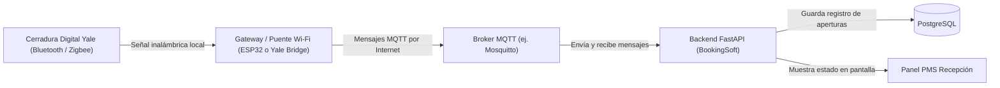

# Propuesta de Arquitectura IoT — Cerraduras Digitales Yale (Bonificación)

**Proyecto:** BookingSoft PMS — Apartahotel Facile  
**Criterio:** Criterio 6 (Bonificación IoT)  
**Estado actual:** **Propuesta técnica de diseño para Fase 2** (en el PMS actual existe la casilla informativa en Walk-In, pero no hay hardware físico ni broker MQTT conectado todavía).

---

## 1. Qué problema queremos resolver con IoT en el hotel

Hoy, cuando un huésped hace su Check-In en recepción, se le entrega una llave física tradicional. Si llega tarde en la noche o en temporada alta, depende siempre de esperar en recepción y existe el riesgo de pérdida de llaves.

La idea con esta propuesta IoT es conectar cerraduras inteligentes **Yale** al sistema **BookingSoft** para que, cuando se confirme un Check-In, el servidor pueda enviarle un **PIN temporal de 6 dígitos** que solo funcione desde su fecha de entrada hasta su fecha de salida, y se desactive automáticamente al hacer Check-Out.

---

## 2. Cómo viajarían los datos (Arquitectura propuesta)



### Cómo funciona paso a paso:
1. En el PMS, el recepcionista registra el Check-In de la reserva.
2. El backend FastAPI genera el PIN temporal (con fecha de inicio y vencimiento) y lo publica en el **Broker MQTT**.
3. El **Bridge/Gateway Wi-Fi** instalado en el pasillo del apartahotel recibe ese mensaje de Internet y se lo pasa por Bluetooth/Zigbee a la cerradura de la puerta correspondiente.
4. Cuando el huésped digita el código y abre la puerta, la cerradura avisa de vuelta al servidor si la puerta abrió bien o cuánta batería le queda.

---

## 3. Protocolo de comunicación usado: MQTT

Para esta comunicación proponemos usar el protocolo **MQTT** (*Message Queuing Telemetry Transport*) en lugar de peticiones HTTP normales.

### ¿Por qué MQTT y no HTTP?
- Las cerraduras y microcontroladores (como un ESP32) funcionan con baterías y poca memoria; HTTP pesa más porque abre y cierra conexiones todo el tiempo.
- **MQTT funciona por publicación y suscripción (Tópicos):** es súper liviano, gasta muy poca batería y permite que la cerradura reciba avisos instantáneos del servidor sin estar preguntando cada segundo *"¿hay algo nuevo?"*.

### Tópicos (canales) propuestos:
- `hotel/facile/cerraduras/{id_habitacion}/crear_pin` ➔ El backend envía el código nuevo a la puerta.
- `hotel/facile/cerraduras/{id_habitacion}/borrar_pin` ➔ El backend borra el código cuando el huésped hace Check-Out.
- `hotel/facile/cerraduras/{id_habitacion}/eventos` ➔ La puerta avisa al sistema cuando alguien entra o si queda poca batería.

---

## 4. Ejemplo sencillo de los mensajes JSON

**Cuando BookingSoft le envía el código temporal a la cerradura:**
```json
{
  "id_habitacion": 101,
  "pin_acceso": "847291",
  "valido_desde": "2026-11-20T15:00:00",
  "valido_hasta": "2026-11-22T11:00:00"
}
```

**Cuando la cerradura avisa al sistema que el huésped abrió la puerta:**
```json
{
  "dispositivo": "YALE-APTO-101",
  "id_habitacion": 101,
  "evento": "PUERTA_ABIERTA",
  "bateria_porcentaje": 89,
  "exitoso": true
}
```

---

## 5. Qué tenemos hoy en el código y transparencia ante el instructor

En la interfaz actual del PMS ([VistaPms.jsx](file:///home/davidl/Documentos/PROYECTO_FACILE/frontend/src/views/VistaPms.jsx)), dentro del módulo Walk-In ya incluimos la casilla visual de **Check-In Directo — Yale Connect Smartlock**.

Con total sinceridad: como no contamos con las cerraduras físicas ni con un gateway en el ambiente de formación, **la conexión física por MQTT no está implementada en el backend**. Lo que sí hace hoy el sistema de verdad es el registro real del Check-In en PostgreSQL (`estado = 'Check-In'`, `checkin_at` y habitación en `'Ocupada'`), dejando lista esta especificación para conectarlo al hardware en Fase 2.
